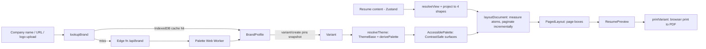

# Resume builder: how it works (for Rakendu)

You type your resume once. For each job application you add a **variant**: you name the company (or paste its URL), the app fetches the company's logo, pulls its colors, and generates a theme. The same content then renders as paged A4/Letter in that company's colors. The preview *is* the PDF: export uses browser print on the exact same DOM.

- **Themes are data, not components.** Every section reduces to one of 4 shapes (entries, tags, prose, identity). A theme picks a layout and one block style per shape, so a generated theme is an archetype plus colors, and a new section works in every theme automatically. Bespoke presets (Netflix-style) are one folder: data plus a couple of constrained components.
- **Contrast can't fail.** Logo colors go through `derivePalette`. Every text and icon color is a `ContrastSafe` type that only `ensureContrast` can create, tied to the background it was checked against.
- **Fast typing.** Zustand with per-field selectors, a deferred preview, re-measuring only the changed block, and re-paginating from that page until the layout converges.

**Folders (`src/`):** `domain/` (model and commands), `sections/<kind>/` (one folder per section), `store/`, `storage/`, `io/` (JSON / JSON Resume), `brand/` (plus `api/brand` edge function), `themes/` (archetypes, `presets/<id>/`, `color/`), `primitives/` (block kit), `icons/`, `engine/` (pagination), `render/` (preview and print), `editor/` (light UI), `app/`. Each folder is importable only via its `index.ts`.

**v1 milestones**
1. **Core model and editor:** domain + `applyCommand`, the section kinds, Zustand store, IndexedDB autosave, generated forms, keyboard-accessible reorder. CI from day one: size-limit, axe, typing benchmark.
2. **Contrast core:** `ensureContrast` / `derivePalette` with 10k-case property tests and fixture palettes.
3. **Engine and preview:** primitives, measurer, incremental + convergent pagination, `ResumePreview`, `printVariant` with the `ats-plain` and `classic` archetypes, plus a Chromium tagged-PDF spike.
4. **Brand pipeline:** logo upload + worker first, then the edge function, IndexedDB brand cache, company dialog, variants, swatch picker.
4b. **AI persona:** site text -> LLM -> validated CompanyPersona (vocab + centerpiece from a fixed registry, score dial first), personalized with the candidate's own content, cached per company.
5. **More archetypes and icons:** `sidebar` and `app-ui` (multi-region, bands), icon toggles and styles, customization panel.
6. **Bespoke presets:** the Netflix-style preset via `BespokeBlock`, plus axe across presets × fixture brands.
7. **Interchange and polish:** native and JSON Resume import/export, duplicate resume, multi-tab lock, mobile preview-only route, perf budget sign-off.
8. **Backend and auth (after v1):** sign-in (magic link or Google, e.g. Supabase Auth or Better Auth), resumes and variants synced to a database across devices while staying offline-first, and a small typed API with per-user access rules.
